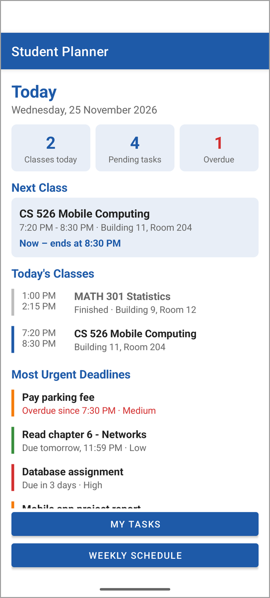
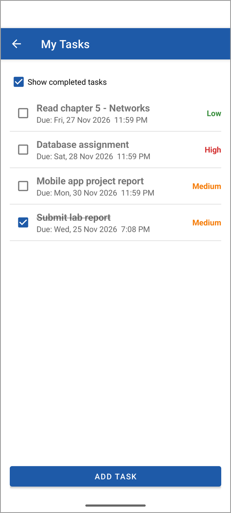
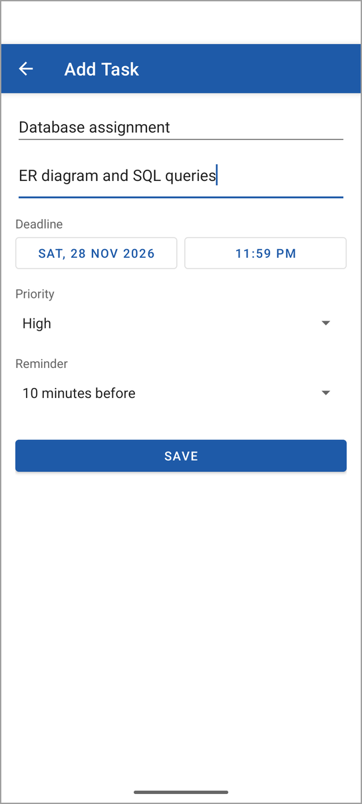
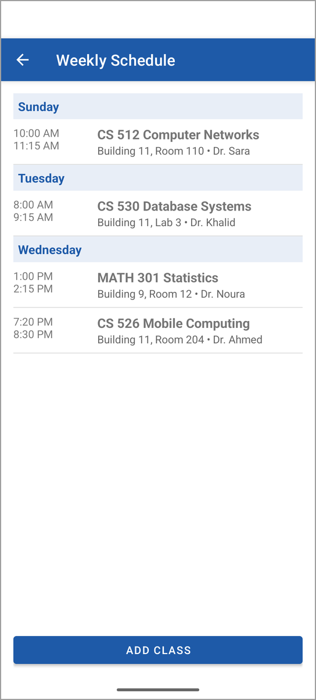
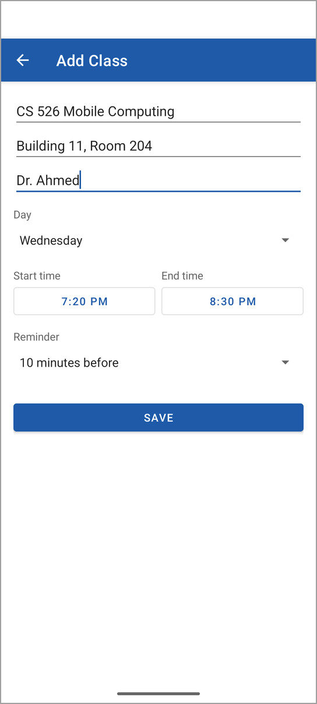
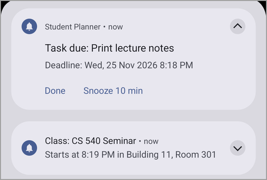
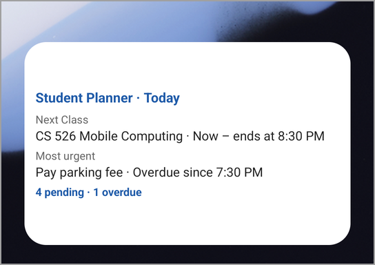
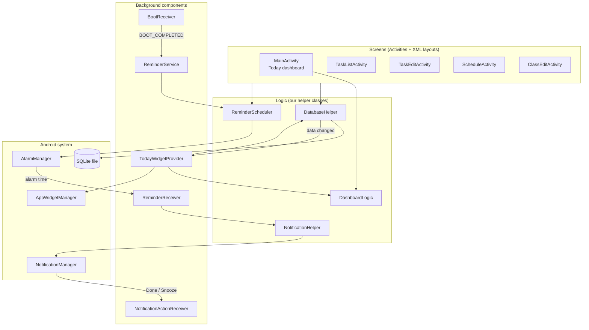

# Student Planner

An Android app for university students that keeps **tasks, deadlines and the weekly class schedule in one place**, and **reminds the student before every deadline and every class**.

Built for the course **CS 526 – Mobile Application Programming** (Group 5), for the project topic *"Mobile App for Tasks and Class Schedule with Reminders"*.

The app is intentionally simple: plain Java and XML, no account, no internet, and all data stays on the phone.

<p>
  
  
  
  
</p>

---

## What the app does

| Feature | What the student can do |
|---|---|
| **Today dashboard** | See today at a glance: number of classes today, pending tasks and overdue tasks; the class happening now or starting next (with a countdown); all of today's classes; and the 5 most urgent deadlines. |
| **Tasks** | Add, edit, delete and complete tasks with a title, description, deadline (date + time), priority (Low / Medium / High) and a reminder time. Share a task as text with any app. |
| **Weekly schedule** | Enter each class once (course, room, instructor, day, start and end time). The schedule is grouped by day, Sunday to Saturday. |
| **Reminders** | A notification before every deadline and every class (at the time, 10 min, 30 min, 1 hour or 1 day before). Class reminders repeat every week. |
| **Done / Snooze** | Task reminders have a **Done** button (marks the task completed) and a **Snooze 10 min** button. Class reminders have **Snooze 10 min**. |
| **Home-screen widget** | Shows the next class, the most urgent task and "N pending · N overdue" without opening the app. |
| **Survives restarts** | Reminders are set again automatically after the phone restarts. |

<p>
  
  
  
</p>

---

## How we built it

- **Language / UI:** Java 17, XML layouts, AndroidX AppCompat and Material Components
- **Storage:** SQLite through `SQLiteOpenHelper` (two tables: `tasks` and `classes`)
- **Background work:** `AlarmManager`, `BroadcastReceiver`, a started `Service`, notifications with action buttons, and an `AppWidgetProvider`
- **Supported Android versions:** Android 7.0 (API 24) up to Android 16 (API 36)
- **Tools:** Android Studio, Gradle 8.14.3, Android Gradle Plugin 8.12.0

### Architecture



### Android components

| Component | Count | Classes |
|---|---|---|
| Activities | 5 | `MainActivity`, `TaskListActivity`, `TaskEditActivity`, `ScheduleActivity`, `ClassEditActivity` |
| Service | 1 | `ReminderService` – re-schedules every reminder on a background thread |
| Broadcast receivers | 3 | `ReminderReceiver` (alarm → notification), `BootReceiver` (after restart), `NotificationActionReceiver` (Done / Snooze) |
| App widget | 1 | `TodayWidgetProvider` |
| SQLite database | 1 (2 tables) | `DatabaseHelper` |

### All Java classes

| Group | Classes | Job |
|---|---|---|
| Screens | `MainActivity`, `TaskListActivity`, `TaskEditActivity`, `ScheduleActivity`, `ClassEditActivity` | What the user sees and taps |
| Lists | `TaskAdapter`, `ClassAdapter` | Turn each task / class into one row of a `ListView` |
| Data | `Task`, `ClassSession`, `DatabaseHelper` | Hold one record; read and write SQLite |
| Reminders | `ReminderScheduler`, `ReminderReceiver`, `NotificationHelper` | Set alarms; show the notification when an alarm fires |
| Notification buttons | `NotificationActionReceiver` | Handle Done and Snooze |
| After a restart | `BootReceiver`, `ReminderService` | Set every alarm again after the phone reboots |
| Dashboard + widget | `DashboardLogic`, `TodayWidgetProvider` | Next class and most urgent tasks; home-screen widget |
| Helpers | `FormatUtils`, `InsetsHelper` | Format dates and times; keep content clear of the system bars |

---

## How the main features work

**Saving data.** `DatabaseHelper` is a singleton `SQLiteOpenHelper`. Dates are stored in milliseconds and class times in minutes after midnight (8:30 AM = 510), which makes sorting easy. All queries use `?` parameters. After every insert, update or delete it calls `dataChanged()`, which refreshes the widget.

**Screens and intents.** The screens are connected with explicit intents. When a task or class is edited, its id is passed as an extra (`task_id` / `class_id`); without an id the same screen creates a new record. Sharing a task uses an implicit intent (`ACTION_SEND`) with a chooser.

**Setting a reminder.** `ReminderScheduler.scheduleTask()` calculates *deadline − reminder minutes* and sets an exact alarm with `AlarmManager.setExactAndAllowWhileIdle()`. For classes, `nextClassReminderTime()` finds the next date on that weekday and adds a week if the time has already passed. Each task and class has its own `PendingIntent` request code (`id × 2` for tasks, `id × 2 + 1` for classes), so alarms never replace each other.

**When a reminder rings.** `AlarmManager` sends the broadcast to `ReminderReceiver`, which loads the task or class, skips completed or deleted tasks, and shows the notification through `NotificationHelper`. For classes it immediately schedules next week's reminder.

**Done and Snooze.** The notification buttons send a broadcast to `NotificationActionReceiver`. **Done** marks the task completed and cancels its alarm. **Snooze** sets a one-time alarm 10 minutes later with a *separate* request code, so snoozing a class never removes next week's class reminder.

**After a restart.** Android deletes all alarms when the phone restarts. `BootReceiver` listens for `BOOT_COMPLETED` and starts `ReminderService`, which reads every task and class on a background thread, sets their alarms again and stops itself.

**Today dashboard.** `MainActivity.showDashboard()` runs in `onResume()`. The calculations are in `DashboardLogic` (plain Java):
- `nextClass()` – the first class today that has not ended yet; `describeNextClass()` → "Starts in 1 h 25 min" or "Now – ends at 8:30 PM".
- `mostUrgent()` – overdue tasks first, then by the day they are due, and on the same day **High priority first**; `describeDeadline()` → "Due tomorrow", "Overdue by 2 days".

**Home-screen widget.** `TodayWidgetProvider` builds a `RemoteViews` from `widget_today.xml` using the same `DashboardLogic`. Android updates it every 30 minutes (`today_widget_info.xml`), and the app refreshes it after every data change.

**Permissions.** `POST_NOTIFICATIONS` (asked on first launch, Android 13+), `USE_EXACT_ALARM` / `SCHEDULE_EXACT_ALARM` (reminders on the exact minute), and `RECEIVE_BOOT_COMPLETED` (restore reminders after a restart).

---

## Testing

- **17 manual test cases** on the Android Emulator (Pixel 6, Android 16), covering tasks, classes, input validation, reminders, restart, sharing, the dashboard, Done/Snooze and the widget. All passed. Reminder times were checked with `adb shell dumpsys alarm`.
- **8 JUnit unit tests** for the dashboard logic in `app/src/test/.../DashboardLogicTest.java` (ranking, deadline wording, next class). They run on the computer without a phone. All passed.

Problems we found during testing and fixed:

1. On Android 15+ apps are drawn edge-to-edge, so content went under the system bars. We added `InsetsHelper`, which adds the right padding on every screen.
2. On Android 14+ exact alarms are off by default, so reminders could be up to an hour late. We added `USE_EXACT_ALARM` and confirmed that the alarms became exact.
3. Snoozing a class could have replaced next week's class reminder. Snoozed alarms now use their own request code.

---

## How to run

1. Install **Android Studio**.
2. *File → Open* → choose this folder and wait for the Gradle sync to finish.
3. Start an emulator (any phone with Android 7.0 or newer) or connect a phone with USB debugging.
4. Press **Run ▶**. On the first launch tap **Allow** for notifications.
5. Optional: long-press the home screen → **Widgets** → **Student Planner** → **Add**.

From a terminal (Windows PowerShell, using Android Studio's bundled Java):

```powershell
$env:JAVA_HOME = "C:\Program Files\Android\Android Studio\jbr"
.\gradlew.bat assembleDebug        # build the APK (app/build/outputs/apk/debug/)
.\gradlew.bat testDebugUnitTest    # run the unit tests
```

---

## Project structure

```
app/
├─ build.gradle                       SDK versions and libraries
└─ src/
   ├─ main/
   │  ├─ AndroidManifest.xml          activities, receivers, service, widget, permissions
   │  ├─ java/com/group5/studentplanner/   the 20 Java classes
   │  └─ res/
   │     ├─ layout/                   screens, list rows and the widget layout
   │     ├─ values/                   strings, colours and styles
   │     ├─ drawable/, mipmap-*/      icons and backgrounds
   │     └─ xml/today_widget_info.xml widget size and update period
   └─ test/java/com/group5/studentplanner/DashboardLogicTest.java
docs/screenshots/                     screenshots used in this README
```

---

## Ideas for the future

- Cloud backup and sync between devices
- Repeating tasks
- Importing the timetable from the university system
- Dark mode
